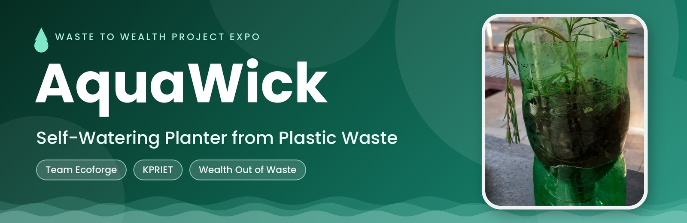
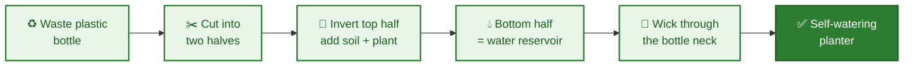
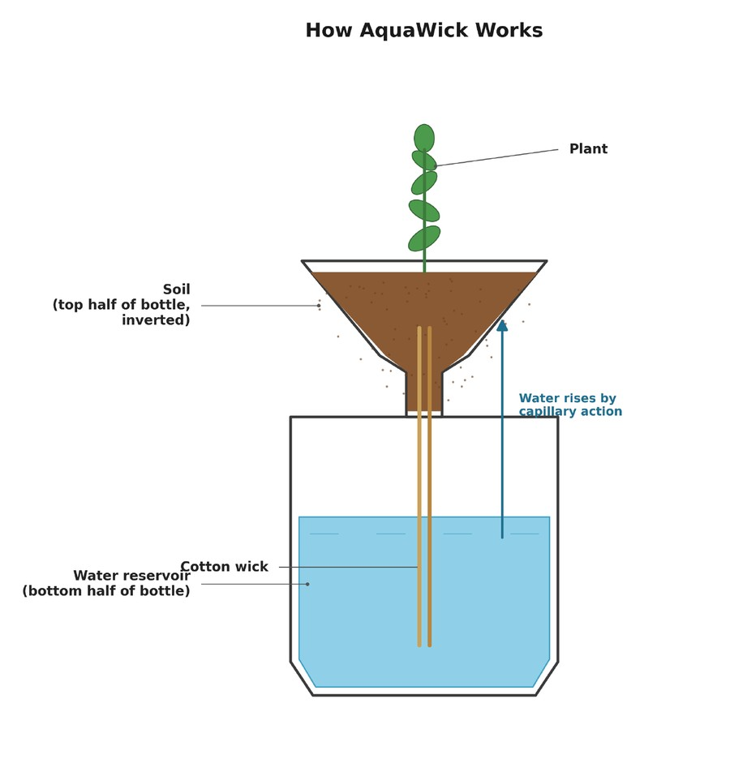
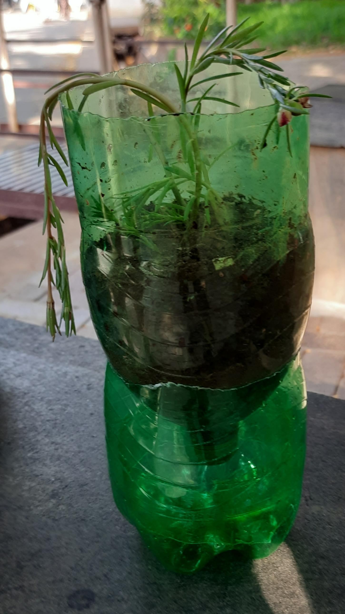
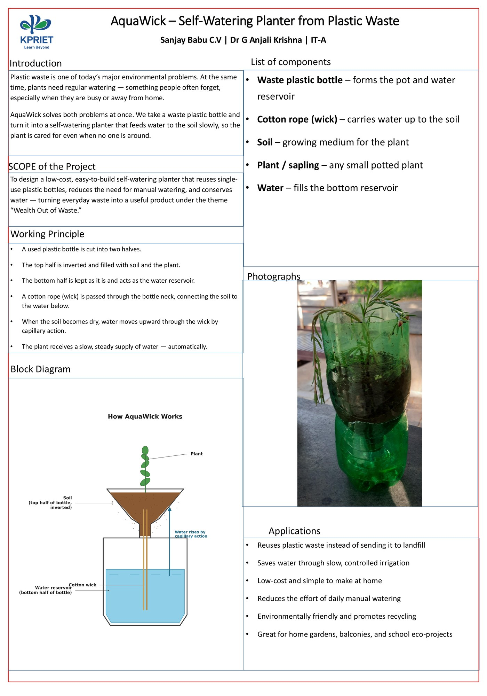

 

 

**[Overview](#-overview)** · **[Event](#-event-details)** · **[Team](#-team-ecoforge)** · **[Components](#-components)** · **[How It Works](#-working-principle)** · **[Showcase](#-showcase)** · **[Contributions](#-contributions)**

---

## 📖 Overview

**AquaWick** is a low-cost, sustainability-focused engineering prototype that turns a discarded single-use plastic bottle into a self-watering planter. A cotton rope (wick) connects the soil in the top half of the bottle to a water reservoir in the bottom half, so the plant receives water automatically through passive capillary action — tackling plastic waste and irregular plant watering at the same time.

The project was built by **Team Ecoforge** and presented at the **Waste to Wealth Project Expo** at **KPR Institute of Engineering and Technology (KPRIET)** on **8 September 2026**, under the theme **"Wealth Out of Waste."**

| ♻️ **Reused** | 🧵 **Capillary Wick** | ⚡ **No Electricity** | 💧 **Self-Regulating** |
|:---:|:---:|:---:|:---:|
| A waste plastic bottle gets a second life | A cotton rope draws water up to the soil | Passive — no pump or power needed | Flow slows as the soil turns moist |

---

## 🎪 Event Details

| | |
|---|---|
| **Event** | Waste to Wealth Project Expo |
| **Organised by** | Department of Science and Humanities, KPRIET |
| **Institution** | KPR Institute of Engineering and Technology (KPRIET) |
| **Date** | 8 September 2026 |
| **Project Title** | AquaWick – Self-Watering Planter from Plastic Waste |
| **Theme** | Wealth Out of Waste |
| **Team Name** | Ecoforge |
| **Class** | IT-A |

---

## 👥 Team Ecoforge

| Name | Role |
|---|---|
| **Sanjay Babu C V** | ⭐ Team Leader |
| **Joffin Ranjith A G** | Team Member |
| **Sabari Murugesh S** | Team Member |
| **Hariharasudhan S M** | Team Member |
| **Sanjeev** | Team Member |

> **Mentor:** Dr G Anjali Krishna

---

## 🚩 Problem Statement

1. **Plastic waste accumulation:** Plastic waste is one of today's major environmental problems.
2. **Irregular plant watering:** Plants need regular watering — something people often forget, especially when they are busy or away from home.

AquaWick solves both problems at once. It takes a waste plastic bottle and turns it into a self-watering planter that feeds water to the soil slowly, so the plant is cared for even when no one is around.

---

## 🎯 Scope of the Project

To design a low-cost, easy-to-build self-watering planter that reuses single-use plastic bottles, reduces the need for manual watering, and conserves water — turning everyday waste into a useful product under the theme **"Wealth Out of Waste."**

---

## 🧰 Components

| Component | Details | Purpose |
|---|---|---|
| **Waste plastic bottle** | Used single-use plastic bottle | Forms the pot and water reservoir |
| **Cotton rope (wick)** | Natural cotton rope | Carries water up to the soil |
| **Soil** | Potting / garden soil | Growing medium for the plant |
| **Plant / sapling** | Portulaca (moss rose) in the prototype | Any small potted plant |
| **Water** | Clean water | Fills the bottom reservoir |

---

## 🔬 Working Principle

AquaWick works on **capillary action** — the movement of water through narrow, porous spaces, such as the fibres of a cotton rope, without any pump or electricity.

1. A used plastic bottle is cut into two halves.
2. The top half is inverted (neck facing downward) and filled with soil and the plant.
3. The bottom half is kept as it is and acts as the water reservoir.
4. A cotton rope (wick) is passed through the bottle neck, connecting the soil to the water below — one end sits in the soil, the other dips into the water.
5. When the soil becomes dry, water moves upward through the wick by capillary action.
6. The plant receives a slow, steady supply of water — automatically.

> [!NOTE]
> AquaWick is completely passive. As the soil becomes moist, the flow slows down, so the planter regulates itself — no pump, no electricity, no moving parts.

### From Waste to Planter

### Block Diagram

---

## 📸 Showcase

| 🌿 Working Prototype | 🖼️ Project Poster |
|:---:|:---:|
|  |  |
| *A cut green plastic bottle with a Portulaca (moss rose) sapling in the inverted top half and the water reservoir below.* | *Designed for the expo — click to open the full poster.* |

📄 **[Download the full poster (PDF)](assets/poster/AquaWick_Poster.pdf)**

---

## 🌍 Applications

- ♻️ Reuses plastic waste instead of sending it to landfill
- 💧 Saves water through slow, controlled irrigation
- 💰 Low-cost and simple to make at home
- ⏱️ Reduces the effort of daily manual watering
- 🌎 Environmentally friendly and promotes recycling
- 🏡 Great for home gardens, balconies, and school eco-projects

---

## 🤝 Contributions

| Member | Contribution |
|---|---|
| **Joffin Ranjith A G** | Project ideation; poster design and creation |
| Sanjay Babu C V | _Team Leader — add your contribution via pull request_ |
| Sabari Murugesh S | _Add your contribution via pull request_ |
| Hariharasudhan S M | _Add your contribution via pull request_ |
| Sanjeev | _Add your contribution via pull request_ |

---

## 📚 Documentation

- 🔧 [Design & Fabrication Notes](docs/DESIGN_AND_FABRICATION.md) — fabrication steps, capillary physics, and maintenance notes
- 📄 [Project poster (PDF)](assets/poster/AquaWick_Poster.pdf)
- 📷 [Prototype photograph](assets/images/AquaWick_Prototype.jpg)

---

## 📜 License

This project is released under the [MIT License](LICENSE).

---

**♻️ Wealth Out of Waste ♻️**

Made with 💚 by **Team Ecoforge** · KPR Institute of Engineering and Technology · 2026

<a href="#top">⬆ Back to top</a>

